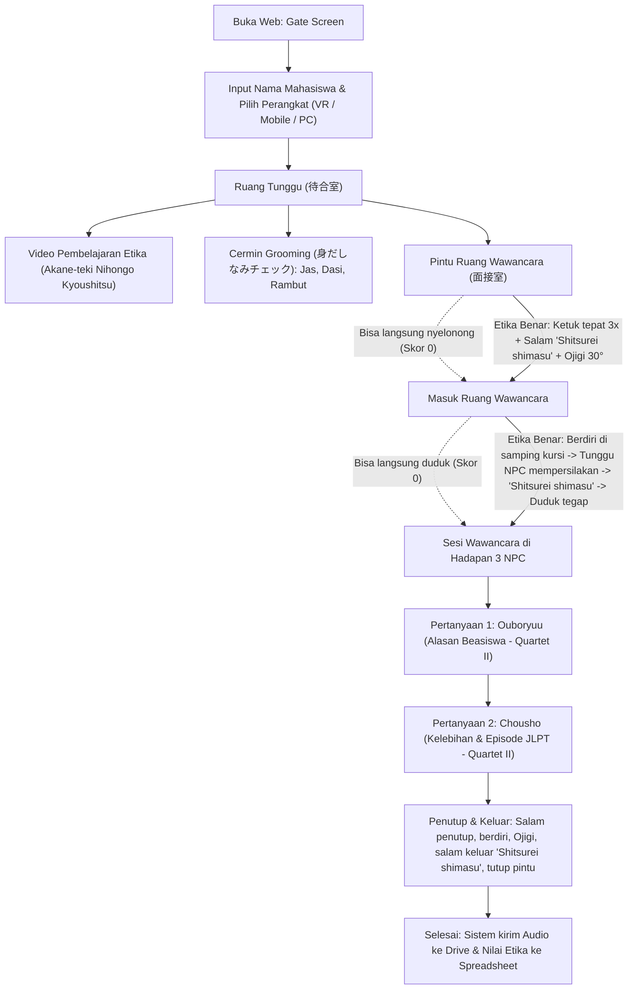

# ARCHITECTURE — Mensetsu VR Room

> **Sistem Simulasi Wawancara Beasiswa S2 / Akademis Jepang (面接シミュレーション)**
> Berbasis Web 3D & WebXR (A-Frame / Three.js).
> Sumber Materi: *YouTube Akane-teki Nihongo Kyoushitsu* (Etika Wawancara) & *Buku Quartet II Bab 10 Hal. 120–125* (Struktur Jawaban Formal).

---

## 1. Persona & Sudut Pandang

| Peran | Deskripsi & Kebutuhan |
|---|---|
| **Mahasiswa (Kandidat)** | Berlatih wawancara beasiswa S2 Jepang secara mandiri: belajar video di waiting room, merapikan diri di cermin, masuk ruang wawancara, menghadapi 3 pewawancara, dan menjawab pertanyaan secara lisan. |
| **Sensei (Penilai)** | Memeriksa performa seluruh mahasiswa di **satu Google Spreadsheet terpusat**. Mendengarkan file rekaman audio di Google Drive, melihat skor etika otomatis dari sistem, dan memasukkan nilai bahasa serta struktur jawaban. |
| **Developer / Builder** | Kita sendiri. Berperan ganda sebagai developer sekaligus sensei: memastikan sistem teknis stabil, ringan di mobile, dan secara pedagogis akurat sesuai etika wawancara kerja/beasiswa Jepang asli. |

---

## 2. Arsitektur Multi-Device (Adaptive Gameplay)

Di awal web dibuka (Gate Screen), mahasiswa memilih perangkat yang digunakan:

```
                          ┌──► [1] VR Headset (Meta Quest / WebXR)
                          │    - 6DoF Controllers (ayunan ketuk pintu, gestur fisik)
                          │    - Real-time Headset Gaze Tracking ke wajah NPC
                          │    - Mode imersif penuh
                          │
[Gate Screen: Input Nama] ┼──► [2] Smartphone / Mobile (Touchscreen)
                          │    - Virtual Analog Joystick (sisi kiri) untuk gerak
                          │    - Touch Swipe Camera (sisi kanan) untuk toleh pandangan
                          │    - Gamepad Xbox ABXY: Y (Aksi/Interaksi), X (Ketuk 3x),
                          │      B (Open Mic/Rekam Suara), A (Ojigi 30° / Salam)
                          │    - Tombol Toggle Layar Penuh (Fullscreen API / PWA Guide)
                          │
                          └──► [3] Laptop / PC (Desktop)
                               - Kontrol WASD untuk gerak + Mouse look
                               - Shortcut keyboard: 'F' / 'Y' (Interaksi), 'K' / 'X' (Ketuk),
                                 'B' (Mic), 'O' (Ojigi), 'C' (Duduk/Berdiri)
```

---

## 3. Alur Pengguna (Sandbox & Non-Linear Manner Test)

> ⚠️ **Prinsip Penting:** Sistem **TIDAK MEMAKSA** alur menjadi linier yang mengunci user. Mahasiswa diberikan kebebasan penuh. Jika mahasiswa langsung nyelonong masuk tanpa ketuk pintu, atau langsung duduk sebelum dipersilakan, **sistem tidak memblokir mereka**, melainkan **mencatatnya sebagai poin minus pada Kategori Etika**.



---

## 4. Konfigurasi 3 NPC Pewawancara (Mensetsukan)

Di dalam `interview-room.html`, terdapat meja wawancara panjang dengan **3 NPC 3D Rigged**:

1. **NPC 1 (Kiri - Pewawancara Aktif / Pria):**
   - Bertugas menyapa awal dan mengajukan Pertanyaan 1 (Alasan Beasiswa / *Ouboryuu*).
   - Suara: Natural Japanese Male Voice Audio.
2. **NPC 2 (Tengah - Ketua Pewawancara & Observer / Pria):**
   - Bertugas sebagai pendengar utama (*Chousha*) dan pencatat berkas (*Observer/Note-taker*).
   - Mempersilakan duduk: 「〇〇さんですね。どうぞそちらにおかけください。」
   - Menutup wawancara: 「なるほど、よく分かりました。では面接は以上です。」
   - Animasi: Mengangguk (*Aizuchi*), mencatat di dokumen/laptop, menatap kandidat.
3. **NPC 3 (Kanan - Pewawancara Aktif / Wanita):**
   - Bertugas mengajukan Pertanyaan 2 (Kelebihan Diri & Pengalaman Konkret / *Chousho*).
   - Suara: Natural Japanese Female Voice Audio.

---

## 5. Sistem Penilaian (Assessment Matrix 100 Poin)

Sistem memadukan **evaluasi otomatis sistem** untuk perilaku fisik/etika dan **evaluasi manual Sensei** untuk audio lisan:

```
Total Nilai (100 Poin) = 
  [Kategori 1: Etika & Postur (30 Poin)]  ---> Otomatis oleh Sistem Web
+ [Kategori 2: Bahasa & Kelancaran (35 Poin)] ---> Manual oleh Sensei via Audio
+ [Kategori 3: Struktur Jawaban (35 Poin)]    ---> Manual oleh Sensei via Audio
```

### 5.1 Kategori 1: Etika & Postur (Maks 30 Poin — Evaluasi Otomatis Web)
Sistem memiliki detektor perilaku independen (*flag tracker*):
- **Ketukan Pintu (5 Poin):** Tepat 3 kali ketukan sebelum membuka pintu. (Jika 0x = 0p; jika 2x atau >3x = 2p).
- **Salam Masuk (5 Poin):** Mengucapkan/menekan tombol salam 「失礼します」 saat membuka pintu.
- **Ojigi Masuk & Salam (5 Poin):** Menunduk 30 derajat saat pertama kali masuk ke ruangan.
- **Etika Duduk (5 Poin):** Menunggu di samping kursi sampai NPC mempersilakan, baru melakukan aksi duduk. (Jika langsung duduk = 0p).
- **Kontak Mata / Gaze (5 Poin):** Kamera/gaze mengarah ke area ketiga NPC minimal 70% dari durasi interaksi.
- **Salam Keluar / Taishitsu (5 Poin):** Salam terima kasih, berdiri, Ojigi perpisahan, salam 「失礼します」 sebelum menutup pintu.

### 5.2 Kategori 2 & 3: Penilaian Manual Sensei (Total 70 Poin)
- **Kategori 2: Bahasa & Kelancaran (35 Poin):**
  - Penggunaan Keigo/Teineigo formal konsisten (15p).
  - Artikulasi & Kejelasan pelafalan (10p).
  - Kelancaran tanpa jeda hening panjang (10p).
- **Kategori 3: Struktur Jawaban Quartet II (35 Poin):**
  - Alasan Melamar Beasiswa / Fokus Riset (10p).
  - Pernyataan Singkat Kelebihan (5p).
  - Episode Konkret Kegagalan & Solusi JLPT (10p).
  - Pembelajaran & Relevansi Masa Depan (10p).
*(Catatan: Transkripsi suara ke teks akan diintegrasikan kemudian saat sistem berlangganan layanan Transkripsi Pro).*

---

## 6. Integrasi Google Drive & Google Spreadsheet

Semua data dari seluruh mahasiswa (siapapun dan di manapun) mengalir ke **satu akun Google milik Sensei (Drive 5TB)**:

```
[Web Browser Mahasiswa]
   │  1. Upload Audio Blob (Base64) per jawaban
   │  2. Payload Skor Etika Otomatis + Metadata
   ▼
[Google Apps Script Web App Endpoint]
   ├── DriveApp: Simpan file audio ke folder terpusat:
   │   "Mensetsu_Recordings / [NamaMahasiswa]_[SessionID] / Jawaban_1.webm"
   │
   └── SpreadsheetApp: Tambah baris baru ke Sheet "Nilai_Wawancara":
```

### Struktur Kolom Google Spreadsheet Terpusat:
1. `Timestamp` (Waktu Ujian)
2. `Session ID` (ID Acak Unik Mahasiswa)
3. `Nama Mahasiswa` (Input di layar awal)
4. `Perangkat` (VR Headset / Mobile / PC)
5. `Status Video` (Sudah Ditonton / Belum)
6. **`Nilai Etika Otomatis (0-30)`** (Hasil deteksi sistem: Ketuk, Ojigi, Duduk, dll.)
7. `Rincian Etika` (Contoh: "Ketuk: 5/5, Ojigi: 5/5, Duduk: 0/5 [Duduk sebelum dipersilakan]")
8. **`Nilai Bahasa & Kelancaran (0-35)`** *(Kolom kosong untuk diisi Sensei)*
9. **`Nilai Struktur Quartet II (0-35)`** *(Kolom kosong untuk diisi Sensei)*
10. **`Total Skor (0-100)`** *(Formula spreadsheet: Etika + Bahasa + Struktur)*
11. `Link Audio Jawaban 1 (Alasan)` (Link Google Drive)
12. `Link Audio Jawaban 2 (Kelebihan)` (Link Google Drive)

---

## 7. Komponen & Modul Teknis Project

```
mensetsu-vr-room/
├── index.html                   # Entry point, Gate input nama & mode device, HUD
├── ARCHITECTURE.md              # Master arsitektur (dokumen ini)
├── RULES.md                     # Aturan pengembangan dan standar kualitas
├── css/
│   └── style.css                # Styling UI overlay, Virtual Joystick, Action buttons
├── js/
│   ├── scene-loader.js          # Loader asinkron template sub-scene
│   ├── interaction.js           # Logika interaksi non-linear (ketuk, pintu, ojigi, duduk)
│   ├── collision.js             # Sistem tabrakan dinding & furnitur
│   ├── audio.js                 # Sound effects & voice playback NPC
│   ├── components/
│   │   ├── player.js            # Komponen kamera, collision, dan gaze tracker
│   │   ├── mobile-controls.js   # Virtual analog joystick + touch camera swipe
│   │   ├── manner-evaluator.js  # Sistem penilai etika otomatis (30 poin)
│   │   ├── voice-recorder.js    # MediaRecorder audio handler + Apps Script sender
│   │   ├── mirror.js            # Planar mirror + Avatar 3D Recruit Suit (berjas & berdasi)
│   │   ├── npc-interviewers.js  # Sistem 3 NPC pewawancara, state machine dialog & animasi
│   │   ├── books.js, dracaena.js, japanese-signs.js # Aset prosedural ruangan
├── scenes/
│   ├── waiting-room.html        # Ruang tunggu (Sofa, TV Pembelajaran Video, Cermin Grooming)
│   └── interview-room.html      # Ruang wawancara (Meja wawancara, 3 NPC, Kursi kandidat)
└── assets/
    ├── candidate.glb            # Model 3D kandidat berjas
    ├── npc_male_1.glb           # Model 3D NPC Pewawancara Pria
    ├── npc_male_2.glb           # Model 3D NPC Observer Pria
    ├── npc_female.glb           # Model 3D NPC Pewawancara Wanita
    └── audio/                   # Voice audio NPC hasil Japanese voice generation (.mp3)
```
